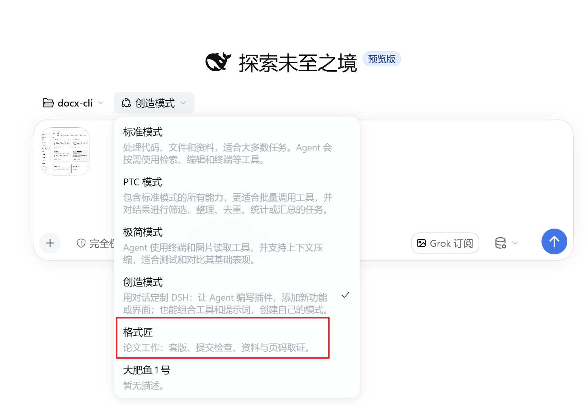

# 格式匠论文助手（DSH 插件）

把本机格式匠的论文工具接进 DeepSeek Harness。插件自己**不实现**论文能力，职责只有四件事：找到格式匠、拉起桥接、断开后重连、把状态和结果讲清楚。所有论文操作仍然是格式匠提供的 `mcp__geshijiang__*` 工具。

## 装之前需要满足的条件

1. 本机装了格式匠（Windows 桌面版），并且本机 MCP 服务是开启状态：格式匠 → 设置 → MCP →「本机服务」里「启用 MCP 本机服务」已打开，并点过「保存并应用」（下面能看到监听端口，默认 48654）。
2. 格式匠里有一条**本机 stdio 安装**：格式匠 → 设置 → MCP → 右上「连接外部助手」→「连接哪个助手」选「DeepSeek Harness」→「执行方式」选「信任所选服务（为当前写工具保存持续授权）」→ 应用。弹出的是「连接外部助手」对话框（`MCPGatewayPanel.vue`），不是「本机服务」页里的 Token/Endpoint 区块。记下生成结果里的 `ins_` 开头安装 ID。插件会优先读格式匠数据库里这条记录；读不到就按配置里的 `installationId` 走。
   - 要选「DeepSeek Harness」，不是「其他本机客户端（stdio 桥接）」：只有这个类型的安装，结构快照确认才默认放行、不弹格式匠原生确认框。类型在建立安装时定下，之后改不了；已经用别的类型接入过的，重新按这个类型连一次，再重跑 `node scripts/gen-preset.mjs` 换掉预设里的安装 ID。
   - 「执行方式」留默认的「改动前确认」，每次写入都会变成格式匠里的待处理项、要再去点一次批准。「信任所选服务」为此刻已发布的写工具保存持续授权；以后新增的写工具仍逐次确认。
3. DSH 里 `@deepseek-ai/dsh-mcp-client` 处于启用状态（官方 profile 默认启用）。插件只是往它上面注册一台服务器，不会自己再插一份。

## 安装

把本目录链接进 profile 并登记为 bundle（以 `desktop` profile 为例，路径按实际改）：

```powershell
$profile = 'C:\Users\<你>\.dsh\profiles\desktop'
$target  = Join-Path $profile 'node_modules\@local\geshijiang-assistant'
New-Item -ItemType Junction -Path $target -Target 'D:\GoRoom\docx-cli\dsh-plugin'
```

然后在这两处各加一项，重启 DeepSeek Harness：

- `package.json` → `dependencies`：`"@local/geshijiang-assistant": "link:D:/GoRoom/docx-cli/dsh-plugin"`
- `package.json` → `dsh.profile.bundles`：`"@local/geshijiang-assistant"`

## 配置

改 profile 里的 `cordis.patch.yml`（`- insert:` 下这条 `id: geshijiang-assistant` 的 `config`）：

| 字段 | 默认 | 说明 |
|---|---|---|
| `executablePath` | 空 | 格式匠程序路径。留空时依次试 `GESHIJIANG_HOME`、桌面 `geshijiang` 目录、`%LOCALAPPDATA%\Programs\geshijiang`、`%ProgramFiles%\geshijiang`。支持安装版 `格式匠.exe` 和发布页便携版 `geshijiang-windows-amd64.exe` |
| `installationId` | 空 | 本机安装 ID。留空时从格式匠数据库里挑一条未吊销的 stdio 安装，优先 `dsh`，其次 `generic_stdio` |
| `dataDir` | 空 | 格式匠数据目录。留空时用 `GESHIJIANG_DATA_DIR`，再退到 `<用户主目录>\geshijiang-data` |
| `startupTimeoutMs` | 90000 | 首次拉起格式匠并等桥接可用的上限 |
| `toolCallTimeoutMs` | 270000 | 单次工具调用超时。格式匠网关自己的写超时是 5 分钟，超过一定被掐断，这里只留 30 秒余量 |
| `autoReconnect` | `true` | 宿主放弃重试（`failed`）后，插件按 15、30、60 秒各重挂一次；装更新、用户完全退出格式匠时不重挂 |
| `mountScope` | `host` | 桥接挂在哪一层。`host` = 本插件在宿主层挂，工具对每个会话都可见；`preset` = 交给「格式匠」预设，只有选这个预设的会话才加载格式匠工具；`off` = 都不挂 |
| `bridgeOnly` | `false` | 只做桥接、不注册工具/提示/技能/命令/面板。给「想让插件自己顶一条预设行」的人用；随附的「格式匠」预设挂的是官方 mcp 客户端，不开这一项 |

## 挂在哪一层：`mountScope` 与「格式匠」预设

格式匠有 110 个工具，工具定义加 instructions 每轮约 17k token。挂在宿主层意味着**每个会话**都付这笔钱，哪怕这个会话在写代码、跟格式匠无关。

`mountScope: preset` 把桥接挪进一个 Agent 预设：宿主这半边的插件照旧（插件页、`/geshijiang` 命令、技能、附件工具都还归它），只有桥接这一件事由预设里的那一份负责。预设作用域里注册的工具只对选了这个预设的会话可见。

**为什么不能继续用 `mcpManager`**：`mcpManager.register()` 是在管理器自己的上下文里挂 mcp 客户端的（`dsh-mcp-manager/src/index.ts` 的 `this.ownerContext.plugin(McpClient, …)`），注册出来的工具属于宿主作用域，换哪个预设都拦不住。所以预设里那一行必须由预设自己挂：现在挂的是官方 `@deepseek-ai/dsh-mcp-client`（插件只在旧的 `bridgeOnly: true` 配置里才自己 `ctx.plugin`，随附预设不用）。

配套的预设 bundle 在 [`preset/`](../preset)：

```powershell
# 生成（DSH 升级后要重跑：预设是完整清单、没有继承，cordis 预设变了这份就得重生成）
node scripts/gen-preset.mjs 'D:\software\deepseek-harness\resources\app.asar' preset

# 安装（或在「插件」→「从本地目录安装」里选 preset 目录）
# plugin_manager action=install_bundle, target = <本目录>\preset
```

生成出来的预设与自带的 `cordis` 预设同一份组成，只在插件列表最后多一条：

```yaml
- id: geshijiang-bridge
  name: '@deepseek-ai/dsh-mcp-client'
  config:
    transport: stdio
    serverName: geshijiang
    command: 'C:\Users\<你>\Desktop\geshijiang\格式匠.exe'
    args: [mcp, bridge, --installation-id, ins_xxxxxxxx]
    failOnStartupError: false
    # 格式匠没运行时不要用光重试额度：默认 10 次（约两分钟）就放弃，
    # 用户过一会儿才打开应用，这个预设就再也没有工具了，只能重开会话。
    reconnect:
      enabled: true
      initialDelayMs: 2000
      maxDelayMs: 15000
      maxAttempts: 5000
```

**为什么挂官方 mcp 客户端，而不是让本插件顶一条 `bridgeOnly` 行**：预设是一份普通的 Cordis 组成，装配期会逐行等每一条 fiber 就绪；多一条自有插件就多一处可能在装配期挂住的地方（踩过一次：预设里的插件行会让选预设的会话卡在「发起会话没反应」）。官方 `@deepseek-ai/dsh-mcp-client` 是 `references/mcp-bundle.md` 写明的用法，装配行为与自带预设里那些行一致。

代价是程序路径与安装 ID 写死在预设里，格式匠换位置或重新配对之后要重跑 `gen-preset.mjs`（它会从 `%TEMP%\dsh-geshijiang-assistant\state.json` 的 `hostTarget` 里读，也可以用 `--command` / `--installation-id` 指定）。

**mcp-client 这个包怎么取到**：插件不在 profile 目录里（是 junction 指过去的），宿主的解析层只把「配置项目作用域里解析得动」的包名路由到安装目录，`@deepseek-ai/dsh-mcp-client` 不在其中，直接 `import` 会得到 `Cannot find package`。三条路依次试（`importMcpClientModule`）：

| 顺序 | 做法 | 依据 |
|---|---|---|
| 1 | `loader.internal.import('@deepseek-ai/dsh-mcp-client', baseUrl)`，`baseUrl` 是 profile 那份 `cordis.patch.yml` 的地址 | profile 里 `name:` 那一行插件名就是这么解析的（`cordis-plugin-loader/lib/index.js:343`），parent 在配置项目作用域里，解析层认得 |
| 2 | 普通 `import` | 宿主没有 `loader` 服务时还能走这条 |
| 3 | 用 `import.meta.resolve('@deepseek-ai/dsh-tools')` 的地址换掉包名那一段（`siblingModuleUrl`） | 两个包同属一个安装目录，绕开解析层的路由规则 |

三条都失败时，失败记录里会带上每一步的原文；`/geshijiang/api/state` 的 `mcpClient` 字段会显示成功走的是哪条（`via`）。

**两份实例之间的交接**：宿主那一份与预设那一份是两次 `apply`，内存不共享，而插件页、`geshijiang_status`、`/geshijiang` 命令都归宿主那一份。它们通过 `%TEMP%\dsh-geshijiang-assistant\state.json` 交换两件事：

| 键 | 谁写 | 用在哪 |
|---|---|---|
| `presetBridge` | 预设那一份（状态变化时 + 每 4 分钟一次） | 宿主的面板与状态工具据此说「预设里现在通没通、几个工具、多久以前」 |
| `hostTarget` | 宿主那一份（一分钟最多一次） | 用户手填了 `executablePath` / `installationId` 时，预设那一份直接沿用，不用在两行里各填一遍 |

记录只在十分钟内算「现在」，更旧的当历史。这个文件读不到、写不进都不影响桥接本身，只是少一条旁证。

**预设那一份断了怎么办**：预设里那一行自己带 `reconnect`（2 秒起、最长 15 秒一次、上限 5000 次），格式匠没开就一直等，不会像默认策略那样两分钟就放弃。所以顺序是：**先让格式匠起来**（`geshijiang_open` 会启动应用并等到端口就绪再返回），起来后最多十几秒桥接自己接上，`mcp__geshijiang__*` 工具随之出现在工具表里。报告「用户完全退出」时不要去猜，直接看端口。

**两份不要同时挂**：`mountScope: host` 还开着的时候，预设里那条也会去挂，同一个会话就会出现两套同名工具。插件会在预设那一份里拦住并报「宿主那半边已经在挂桥接」，看到这句就把 `mountScope` 改成 `preset`。

**验证**：新建会话时选「格式匠」预设 → 工具表里出现 `mcp__geshijiang__*` 与 110 个网关工具；用别的预设开一个会话 → 这些工具一个都不在。设置页 → 格式匠 的第 3 步会写明「桥接挂在『格式匠』预设上」，不再显示「未挂载」的红条；预设里连过之后，那条说明会带上工具数量与「多久以前」。

改 `mountScope` 属于插件配置，改完要重启 DSH 才生效（插件热重载只重建插件实例，不重读 bundle patch）。

DSH 升级后如果忘了重新生成，最坏情况是预设里的组成比当前 `cordis` 旧一步；插件本身不受影响。

## 装好之后怎么用（带图）

下面三张图是第一次用时的完整路径，顺序即点击顺序。截图取自插件 v0.4.6 的桌面版。

**第一步，确认预设装上了**：设置 → Agent 预设 → 拉到底部「自定义」分组，应该能看到「格式匠」卡片（标识 `geshijiang`）。没有就先按上一节装 `preset/`。

**第二步，新会话选它**：输入框左上角的预设切换器（默认写着「创造模式」的那处）点开，选「格式匠」。选别的预设开会话不会加载这些工具，也就不付 110 个工具每轮约 17k token 的开销。



**第三步，核对连接**：设置 → 格式匠 的三步清单都该是绿勾——MCP 服务已开启（带本机端口，默认 48654）、本机安装已就绪（带 `ins_` 安装 ID 与类型）、桥接挂在「格式匠」预设上（本机这步配齐就勾选；预设里真的连过之后，还会带上工具数与「多久以前」）。

连接后，服务名称显示为 `geshijiang-gateway`。第三步显示「未挂载」或有红字时，先看这一页给出的错误原文，或调 `geshijiang_status`。应用没开就先 `geshijiang_open`，桥接连上后，`mcp__geshijiang__*` 工具会出现在工具表里。

## 它给了你什么

**工具（11 个，都归宿主这份：连接诊断 + 聊天身份与附件搬运，不代理业务）**

- `geshijiang_status`：桥接与宿主通道各自的状态、工具数量、重试进度、最近错误、程序与安装 ID 是否找到。连不上时先看它——「桥接没连上」与「宿主通道不可用」是两件事，读它就能分清。
- `geshijiang_connect`：重新发现并挂载桥接。改完配置、或 DSH 放弃重连（重试 10 次后）用它；`mountScope: preset` 时没有归宿主管的连接，它只回答「不用重连」并说明下一步。
- `geshijiang_open`：启动格式匠并**等它的 MCP 端口就绪**再返回（上限 25 秒），告诉你「现在到底能连没有」。起来后桥接自动重连，不用再手动连接；模型在预设会话里发现业务工具不在时，应当先调它。**拉起时不抢焦点**：进程带 `GESHIJIANG_LAUNCH_BACKGROUND=1`，桌面程序只把窗口放进任务栏，不会弹到用户正在看的对话前面。
- `geshijiang_diagnostics`：生成一段可直接复制到工单里的接入信息：状态、程序路径、安装 ID、数据目录、两条通道的状态、最近一次错误原文。**不含 token**。
- `geshijiang_catalog`：列出网关当前暴露的工具、固定资源、资源模板与提示词（名字与一行说明）。用户问「连上了能用哪些」时用它；读一次缓存 10 分钟，`refresh: true` 重新问。
- `geshijiang_disconnect`：主动断开桥接并暂停自动重连，方便调试「连不上」的一侧。断开后所有 `mcp__geshijiang__` 工具都不可用，直到下一次显式连接。
- `geshijiang_stage_attachment`：把用户这次给的文件复制进格式匠收件区，换一个可导入的 `file_id`。不改原件。
- `geshijiang_import_document`：把收件区里的文件导入成新论文或追加版本（`request_id` 必须稳定，重试沿用原编号）。
- `geshijiang_session`：读、绑定或解除本次真实聊天的当前论文。
- `geshijiang_use_attachments`：在本次聊天里导入知识库或整理投稿包，参数与同名格式匠工具一致。
- `geshijiang_save_file`：把格式匠的 `file_id` 存成本机文件，校验大小与摘要，不覆盖已有文件。

这五个搬运/身份类工具走的是 `格式匠.exe mcp host`，**不依赖桥接**：桥接交给预设时，它们在任何会话里都能用。

**连接后获得的能力清单**

连上之后，插件页与设置页会像格式匠自己的「测试连接」面板那样摊开：工具的个数与名单、固定资源、资源模板、提示词，外加服务名与协议版本。数据来自 `格式匠.exe mcp describe --installation-id <id>`——它和桥接读同一份安装描述、走同一套回环校验，只连一次、问完就关。

**这个清单要装带 `mcp describe` 的版本**。旧版本会把这个调用当成启动 GUI，插件识别出「没有清单接口」后只显示一行升级提示，不会把它画成「0 个工具」。

**技能 `geshijiang-paper`**

技能正文按任务链组织：从收稿到交付、套版、提交检查、引文核对、找格式与共坊、资料与投稿、断线恢复。模型只在真要做这些事时才用 `skill` 工具加载，不占每轮系统提示词：

1. 新稿从对话走到成品：`geshijiang_stage_attachment` 把文件复制进收件区并自动登记（这一段走宿主通道，不依赖业务工具在不在表里）→ `geshijiang_import_document` 建论文或追加版本 → `geshijiang_session` 绑定会话 → `read_document_outline` / `read_document_chunk` / `search_document` 读稿 → `create_structure_plan` / `confirm_structure_plan` 确认结构 → `preview_layout_plan` → `apply_layout_as_branch` → `start_diagnostic_run` / `get_diagnostic_status` / `list_findings` 检查 → `generate_commented_docx` / `generate_revision_draft` / `export_diagnostic_report` 导出 → `geshijiang_save_file` 取回成品。
2. 套版：`list_papers` → `list_versions` → `list_layout_configs` → `preview_layout_plan`（可带套用范围）→ 预览后直接 `apply_layout_as_branch`，冲突与影响随结果一起交代。
3. 提交检查：`list_diagnostic_profiles` → `start_diagnostic_run`（或同步 `run_paper_diagnostic`）→ `get_diagnostic_status({ run_id, wait_seconds: 120 })` 一直等到 status 不是 running（还在跑就再调一次，最多 180 秒一次）→ `list_findings` 分页读问题，数字必须有工具结果出处。结果在对话里给出来，不要让用户切到应用里自己看。
4. 引文页码核对：`preview_citation_check` → `start_citation_check` → `list_citation_check_items` → `get_citation_check_item`；缺来源时 `list_citation_source_candidates` 与 `preflight_citation_source`。
5. 找格式与共坊：`search_forge_templates` → `get_forge_template` → `check_forge_import` → 直接 `import_forge_template`（有 notices 时 `confirm_profile_warnings` 传 true，并把 notices 随结果逐条交代）；版式生成任务用 `list_layout_generations` 与 `list_layout_generation_events` 续读。
6. 资料与投稿：`create_knowledge_base` / `import_knowledge_base_files` → `get_rag_run({ run_id, wait_seconds: 120 })` 守到解析结束；`search_knowledge_base` 与跨库 `search_knowledge_bases`；投稿前 `inspect_blind_review`，交付 `build_submission_package`。
7. 断线恢复：`list_interrupted_tasks` 盘点，`resume_import_recovery` 决定资料导入续跑或取消。
8. 审稿意见与回复信：`get_research_context` / `list_submission_requirements` 读口径，`list_review_items` 逐条读意见，`summarize_review_items` 给进度，`export_response_letter` 出回复信并用 `fetch_file` 取回。
9. 星轨：`get_symphony_state` 读状态与运行索引，`get_symphony_report` 读论证审查覆盖（`determined` 与 `insufficient` / `blocked` 分开说），`get_symphony_source_evidence` 读已登记来源证据。
10. 工坊：`list_workshop_runs` 列运行，`get_workshop_run` 读阶段与发现项，`read_workshop_artifact` 按 key 读产物正文（含截断标注）。

技能正文还写了连接异常时先查状态、写操作边界（十七项写工具都受 safe-write 开关约束），以及「卡片已展示的内容不要复述」。写操作默认直接执行：预览或核对拿到令牌、plan_hash 后就调用写入工具，不再停下来征求同意；只有工具自己返回阻断（`verdict=block`、没有令牌、权限或安全写被拒）时才停下来说明原因。格式匠工具描述里的「用户明确确认后」由插件的系统提示词明确覆盖。

**命令 `/geshijiang`**

- `/geshijiang`：一行状态。
- `/geshijiang 诊断`：等价于 `geshijiang_diagnostics`，输出可复制的接入信息。
- `/geshijiang 重连`：卸载旧连接并重新挂载桥接。

**对话里的工具卡**

- 套版方案卡（`mcp__geshijiang__preview_layout_plan`）：判定徽章（可套用 / 有冲突 / 已阻断 / 旧路径）、影响段落数、版式项数、冲突条数与前三条、受保护内容（节 / 表格）、清理会删掉的处数、前四条版式规则及各自影响处数、确认令牌有效期，以及「模型带着令牌直接建分支」的下一步。判定为 `block` 时明确写「没有可用令牌」。
- 提交检查卡（`mcp__geshijiang__run_paper_diagnostic` 与 `mcp__geshijiang__list_findings` 共用一张）：错误 / 警告 / 提示三项计数、逐条问题与定位（来源 + 段落序号 + 摘录）、「只看错误」筛选、「在格式匠中查看报告」与「复制运行 ID」。检查跑完源文件又变过时，卡片会直接写「不能当作当前文件的结论」。
- 状态行（4 个连接工具）：一行，不铺开。

解析不出结构时一律退回原文并标注「未解析」，不编造字段。

**设置页（设置 → 格式匠）**

插件详情页不好找，所以设置侧栏里另给一个同名入口（槽位 `settings.section`，`id: geshijiang`，排在「表情包」之后）。这一页面向第一次用的人：

1. 三步接入清单，每步都写当前状态与下一步点哪里——MCP 服务是否开启（带上本机端口）、有没有可用的本机安装（带上安装 ID 与类型）、桥接通没通（带上工具数或错误原文）。
2. 与插件页共用的三个动作：打开格式匠、重新连接、复制诊断信息（同一套 `useConnectionActions`，行为不会两处不一致）。
3. 「在对话里怎么用」四条示例：套版、提交检查、取证、排障。
4. 本机信息：程序、安装、数据目录、连接方式。

**插件页（插件详情页）**

`plugins.bundle.config` 里的连接卡：状态、工具数、写入是否开启、连接方式、本机端口、程序与安装 ID、数据目录、插件版本。连接断开时给出最近一次错误的原文、自动重试倒计时，以及「打开格式匠」「重新连接」「复制诊断信息」三个按钮。数据来自同源接口 `/geshijiang/api/state`，只允许本机同源页面访问。

## 明确不做的事

- 不代理、不缓存格式匠的业务工具；工具列表完全由格式匠按发布组决定。
- 不读、不保存 token。桥接描述（端点与 token）由格式匠写在受保护存储里，只有桥接进程自己读。
- 不替换 `dsh-mcp-client` 的重连策略。桥接断线由 mcp-client 退避重连，本插件只在「放弃之后」提供一次手动重连。
- 不做格式匠业务规则：写操作的安全边界仍在格式匠一侧（`confirmation_token`、`safe_write`）。
- 不渲染配置表单。配置仍在 `cordis.patch.yml` 里改，插件页只读状态。

## 限制

- 单次工具调用超过格式匠网关 5 分钟写超时会被掐断；`toolCallTimeoutMs` 只是本地等待上限，不能延长服务端。
- **「在格式匠中查看报告」不是深链**。格式匠目前没有 URL scheme（`main.go` 只转文件与 URL 打开事件，`handleMacUrlOpen` 仍是预留），诊断报告又是数据库记录、没有文件路径，所以这个按钮只能唤起格式匠，再由「复制运行 ID」把运行 ID 交给用户在格式匠里查找。等格式匠支持 `geshijiang://` 深链后，这两步可以合成一步。
- 同一台机器多个 DSH 会话共用一个桥接进程时，各会话共用同一份格式匠安装与工具目录。
- macOS 未验证；本插件按 Windows 的路径与进程行为编写。
- 桥接进程是格式匠可执行文件本身。它没有窗口、不读数据库写、不监听端口，但会占用该 exe 的文件句柄。更新脚本现在会先落 `update-in-progress.marker`，桥接两秒内自行退出、脚本等文件释放后再装；这套握手要等含该逻辑的构建才生效，首次更新仍需先关插件或结束无窗口的 `格式匠.exe`。

## 断线之后

1. **宿主自己在试**：`dsh-mcp-client` 按 0.5→30 秒退避重试十次（约 150 秒），期间插件只显示「重新连接中」与剩余秒数，不插手。
2. **宿主放弃了**：状态变 `failed`、工具被撤掉。插件此时按 15、30、60 秒各重挂一次，插件页写清「约 N 秒后自动重连（第 N 次）」。
3. **不该重挂的时候**：安装目录有 `update-in-progress.marker`（正在装更新）就等，装完自动接；错误是「用户完全退出格式匠」就先探网关端口，你手动打开格式匠后才接回。
4. **三次都没成**：停止重试，页面写明「自动重连已停止」。你处理完格式匠那边的问题点「重新连接」即可，这次点击会重新记一轮。
5. **你自己断开**：插件页或设置页的「断开连接」、工具 `geshijiang_disconnect`、命令 `/geshijiang 断开` 都会卸掉桥接并暂停自动重连——调试断线表现时用它，恢复点一次「重新连接」。

桥接挂在预设上时（`mountScope: preset`）上面的「宿主重挂」不适用：断开、重连都归预设里那条 `dsh-mcp-client`。它按预设里写的 `reconnect` 一直重试，所以这时候唯一的动作是**把格式匠拉起来**——`geshijiang_open` 会做这件事，并等到端口就绪再返回；就绪后最多十几秒工具自己回来。应用已经开着却一直没有业务工具，才是「这个会话没选格式匠预设」；宿主工具（附件、会话身份）与这条判断无关，任何时候都可以直接调。

## 插件自己没装好时

装配期的问题不会再拖成整页「读不到状态」：

- 单条工具定义写错只跳过那一条，其余工具、提示词、技能、命令与面板路由照常装。
- `webServer` / `mcpManager` 由宿主不同 bundle 提供，谁先启动没有保证。插件不再把它们写成硬依赖，而是等服务就绪后再装配（`ctx.inject`）；服务缺席时状态里写明「等待 … 服务就绪」，不再永久放弃。
- `/state` 里多了三个字段：`panel`（面板接口挂没挂上，含失败原文）、`faults`（最近 5 条装配失败原文）、`services`（两个宿主服务是否已就绪）；`hints` 会把它们翻成一句人话，`geshijiang_status` 与 `/geshijiang 诊断` 里也能看到。另有 `hostChannel`（宿主通道能不能起来、缺什么）与 `usable`（这套接入有没有配置层面的故障：预设模式下桥接不归宿主，靠它判断），不要拿 `ok` 一个字段读整套状态。
- 插件页与设置页读不到状态时不再只写「正在读取」：会写出 HTTP 状态码或超时原因，并给「重试」按钮。

## 稳定性与资源

插件跑在宿主进程里，所以所有会等、会重、会起进程的地方都设了上限，不存在「一直等」或「越等越频繁」的路径：

| 位置 | 上限 / 处理 |
|---|---|
| 插件页轮询 | 8 秒一次；页面切到后台时不再请求；连续失败 3 次后降到 24 秒一次；切回前台立刻刷新。定时器在卡片卸载时清掉 |
| 面板请求 | 请求体 64KB、读取超时 15 秒；超限回 413、超时回 408，然后主动断开，不占着连接 |
| 页面上的每个请求 | 10 秒上限（AbortController）。失败或超时都会把按钮放回可点状态并写明原因，不会永久禁用 |
| 重连 | 单飞：正在重建时第二次调用直接返回 429，不排队、不叠加注册；失败只记录原因，不留半挂状态，再点一次即可重试 |
| 打开格式匠 | `spawn` 的同步异常与异步 `error` 事件都会被接住并写进状态提示；插件不会因此崩，也不会反复拉起。打开后会等端口就绪，上限 25 秒，等待期间每 600 毫秒探一次，超时照实返回「没就绪」 |
| 自动重连 | 只在宿主 `failed`（十次退避用尽、工具被撤掉）后动手：15、30、60 秒各重挂一次，连上即清零，三次用尽就停并在插件页说明。`connecting` / `reconnecting` 阶段不插手，避免两套退避打架 |
| 自动重连的例外 | 安装目录里有 `update-in-progress.marker`（正在装更新）时不重挂；错误是「用户完全退出格式匠」时先探一次网关端口，端口通了才接回，没开就保持安静 |
| 桥接进程 | 由宿主按 mcpManager 的生命周期管理；插件卸载或 effect 清理时调用 dispose，不保留自己的长连接 |
| 状态读取 | `mcp_settings.json` 有 2 秒缓存；`/state` 不打开格式匠数据库，只有「重新发现安装」时才只读打开一次并立即关闭 |
| 端口探测 | 5 秒缓存一次 TCP 连接，只回答「现在有没有人在听」，不读数据库、不起进程。面板据此把「配置已开启」和「当前未监听」分开写 |
| 桥接旁证 | 只在宿主已放弃连接、且网关确实在监听时启动一次 `mcp bridge` 取子进程 stderr；60 秒最多一次、2.5 秒强制结束。网关在监听意味着桥接不需要自动拉起格式匠，所以这次探测不会变成一次意外启动 |
| 能力清单 | 只在已连接时读，走一次 `mcp describe`（20 秒上限）；成功缓存 10 分钟、失败缓存 6 小时，条目与描述都封顶，避免每次轮询都执行程序、把状态响应撑大 |
| 工具卡渲染 | 问题清单只渲染前 8 条（其余给「另有 N 条」），结果解析按文本缓存，切换筛选不会重新解析大 JSON |

## 与宿主的契约对照

宿主对这些注册对象**大多不做字段校验**：字段名写错不会在挂载时报错，只会在下一次使用时炸在不相关的地方，所以改动前后都按这张表核一遍（路径相对于 DSH 安装目录下的 `app.asar/dsh/node_modules/@deepseek-ai/`）。

唯一在装配期就会硬失败的是工具参数 schema：`defineTool` 同步校验 `parameters`/`output`，`object` 必须显式写 `additionalProperties: true|false`，否则抛 `unsupported JSON schema: parameters.xxx.additionalProperties must be explicitly true or false`，整条 apply 会被掀掉，工具、技能、系统提示与面板路由一起不出现。插件现在给每条工具单独兜底、把它们延迟到服务就绪后装配，所以单条写错只会在状态里留一条「装配失败」，不会连累整个面板。

| 本插件用法 | 宿主契约与位置 |
|---|---|
| `systemPrompt.section({ name, order, text, interpolate })` | `PromptSection` 在 `dsh-system-prompt/src/index.ts:53-76`，注册方法在 `:485`。字段是 **`text`**，没有 `content`；`renderPrompt` 在 `:297-302` 对分节做 `text.length`，缺 `text` 会在每轮装配时抛 `Cannot read properties of undefined (reading 'length')` |
| `tools.register(defineTool({ name, description, parameters, output: { schema, render }, execute }))` | `register` 在 `dsh-tools/src/index.ts:128`，`defineTool` 在 `dsh-tools/src/schema.ts:555`；`output` 必须含 `schema` 与 `render` |
| `mcpManager.register(name, { transport, command, args, startupTimeoutMs, toolCallTimeoutMs })` | `dsh-mcp-manager/src/index.ts:288`；`list()` 返回 `{ name, configured, status }`（`src/types.ts:24-31`）。注意它在**自己的**上下文里挂客户端（`:502` `this.ownerContext.plugin(...)`），所以注册出来的工具永远是宿主作用域 |
| 预设里那一份：`ctx.plugin(McpClient, McpClient.Config({ transport:'stdio', serverName, command, args, … }))` | 插件对象是 `dsh-mcp-client` 的命名空间导出（管理器同样 `import * as McpClient`），`Config` 会补默认值（`src/index.ts:164-193`）；状态用 `connectionStatusOf(handle).current()`（`src/index.ts:66-72`），句柄有 `await()`/`dispose()`（管理器 `:528-542`） |
| `skills.register({ name, description, whenToUse, source, content })` | `dsh-skill/src/index.ts:439`（`SkillRegistry.register`）；`source` 是必填（`SkillSummary.source`，`:40`/`:69`），`provider` 缺省 `runtime`（`:450`），`invocation` 缺省模型与用户都可调用（`:449`）；名字必须是 kebab-case（`validateRuntimeSkill`，`:741-745`） |
| `commands.register({ name, description, input, handler })` | `dsh-commands/src/index.ts:285`；`handler` 收到 `CommandInvocation{ commandId, agent, rawInput, attachments, signal }`（`:41-58`），必须返回 `{ kind: 'success' \| 'error', text }`（`src/types.ts:34-41`）；命令不能发起模型轮次 |
| `webServer.register({ kind: 'prefix', path, handler })` | `dsh-host-webserver/src/index.ts:445`，`WebRoute` 在 `:52-58` |
| `ctx.slots.inject(key, fn)` / `ctx.slots.register({ name, key }, Component)` | `dsh-client-ui-renderer/src/client/registry.ts:209`（`inject`）与 `:741`（`register`）；`tool.call.toolview` 的 `props` 是 `{ phase: 'preparing' \| 'start' \| 'result', block, toolName, ... }`，`result` 阶段的 `block` 才是含 `content` 的结果节点 |
| `ctx.slots.register({ name: 'settings.section', id, order, label }, Component)` | 分节是 list 槽位，`id` 同时是导航行的 key，内容用 `renderSlot('settings.section', { close }, { only: active })` 按 id 过滤；`dsh-client-ui-settings-general/lib/client.js` |
| `ctx.slots.register({ name: 'settings.section.icon', id, order, label }, Icon)` | 图标是另一个 list 槽位，**注册 id 必须等于目标分节的 id**，否则永远不渲染；组件收到 `{ size, active }` |
| 槽位组件的返回值 | 条目会被当成 React 组件渲染（`jsx(Comp, props)`），但**元素类型只能是字符串或函数**：把元素当组件传（`h(SomeElement())`）会抛 `Element type is invalid … got: object`，宿主用 `SlotErrorBoundary` 接住后只留一片空白（`div[data-slot-error]`），页面上什么都看不到。测试替身的 `createElement` 已按同一条规则拒绝非法类型 |

## 测试

```powershell
cd D:\GoRoom\docx-cli\dsh-plugin
npm test
```

两组用例都不需要 DSH 运行时：Host 侧用替身 ctx 校验桥接条目、四个工具、系统提示节、技能、命令与面板鉴权；Client 侧用最小 React 替身摊平组件树，校验槽位注册、插件页连接卡（含「需要修复」态）、两种工具卡的解析与降级。
